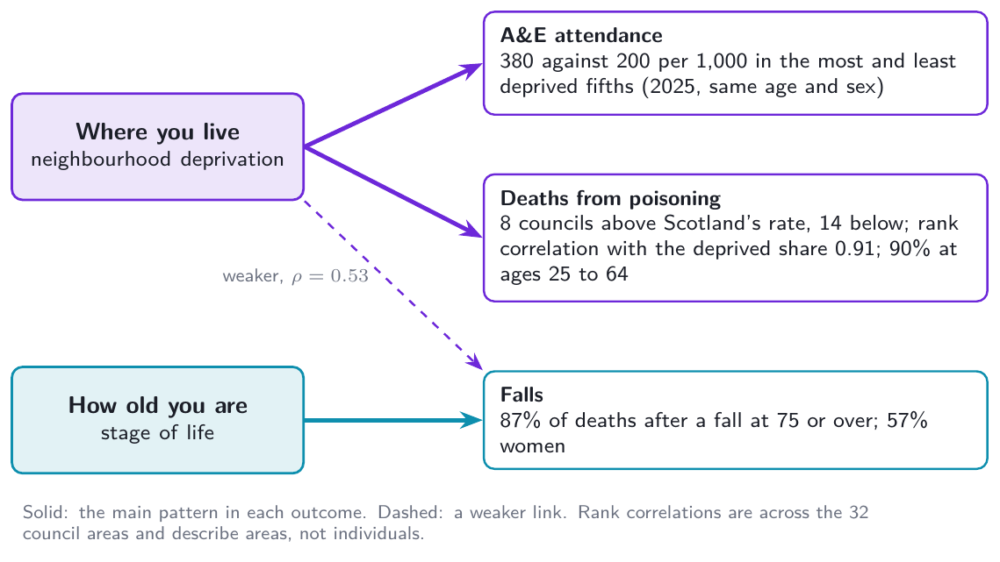
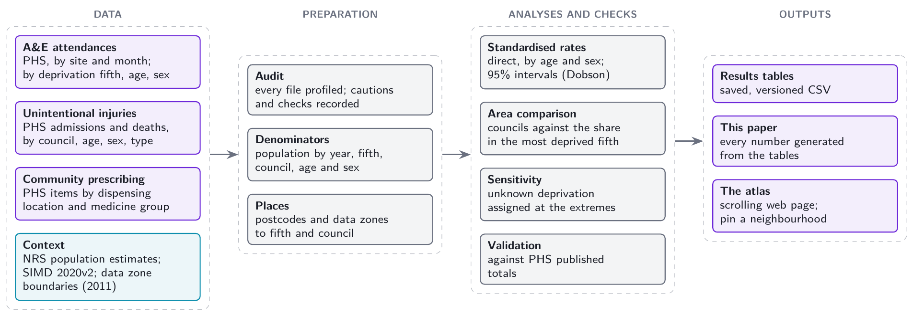

# Scotland Health Atlas

**[Explore the atlas](https://david-alobo.github.io/ScotlandHealthAtlas/)** ·
**[Read the paper](paper/main.pdf)** ·
**[Poster](docs/poster/poster.pdf)**

An open atlas of health in Scotland: A&E attendances, unintentional injuries and community
prescribing, turned into rates by age, sex, place and deprivation, and followed over time. Built
from Public Health Scotland and National Records of Scotland open data, with every figure
traceable to saved tables and the scripts that made them.

<a href="https://david-alobo.github.io/ScotlandHealthAtlas/"></a>

A [Monstrous Data](https://monstrous.com.ng) project by David Obeh Alobo. It began as an entry to
The Data Lab Community's 2026 [data visualisation competition](https://thedatalab.com/data-visualisation-competition/)
(theme: *Telling Scotland's health story*) and is being built further as an open, reproducible
atlas.

## What it shows

Where you live and how old you are shape different health risks.



- **A&E use follows deprivation.** In 2025, people in Scotland's most deprived fifth of
  neighbourhoods attended A&E 380 times per 1,000 people, against 200 in the least deprived fifth
  (same age and sex): a ratio of 1.90, and between 1.90 and 2.09 in every year from 2018. The
  ratio drifted down, but by no more than the growing share of attendances with unknown
  deprivation can explain, so we make no claim that the gap is narrowing.
- **Poisoning deaths follow place.** They rose from 12.7 to 25.9 per 100,000 between 2015 and 2020
  and fell back to 19.1 in 2024. Across the 32 council areas, 8 are clearly above Scotland's rate
  and 14 below, and the rate tracks the share of people in the most deprived fifth (Spearman's
  rho 0.91).
- **Falls follow age.** 87% of deaths after a fall are of people aged 75 or over; 90% of poisoning
  deaths are at ages 25 to 64. Falls admissions track deprivation much less (rho 0.53).
- **Prescribing** looks steeply graded by deprivation, but mostly because pharmacies cluster in
  more deprived data zones; the medicine mix differs too (central nervous system medicines 21.2%
  of items in the most deprived fifth against 16.8% in the least).
- **Checked:** our injury counts match Public Health Scotland's published figures within 1.8%.

Comparisons between council areas describe areas, not individuals. Full methods, figures and
limitations are in the [paper](paper/main.pdf).

## The atlas

One scrolling page, fifteen scenes. Each of Scotland's 6,976 data zones (neighbourhoods of about
800 people) is a dot, brighter where it is more deprived. Search by postcode or neighbourhood name,
or click a dot, to pin a neighbourhood: the cards then show its deprivation, its council's rates
beside Scotland's, and deaths in its council by age. Click anywhere on the map to clear the pin.
Rates based on fewer than 20 deaths are hatched rather than coloured.

## How it is made



1. **Data.** The competition package (A&E, unintentional injuries, prescribing), plus NRS small
   area population estimates, SIMD 2020v2 look-ups and 2011 data zone boundaries.
2. **Preparation.** Every file profiled; populations by year, deprivation fifth, council, age and
   sex; postcodes and data zones placed in fifths and councils.
3. **Analyses and checks.** Rates directly standardised for age and sex (ESP2013 for injuries), 95%
   intervals by the Dobson method, council-level comparison with deprivation, a sensitivity
   analysis for unknown deprivation, and validation against PHS publications.
4. **Outputs.** Dated results tables; the paper's numbers and tables are generated from them
   (`atlas.paper_numbers`), and so is the atlas's data (`atlas.export_web`).

## What is here

| Folder | What it holds |
|---|---|
| `data/` | Where the data comes from (`data/README.md`); raw files are not in git, derived population tables are |
| `src/atlas/` | The pipeline (Python package `atlas`): one module per analysis, plus `stats.py` (rates, intervals, correlation) and `style.py` (figure style) |
| `tests/` | Unit tests (pytest); they need no data, so they run in CI |
| `results/` | Tables, figures and a README for each analysis, dated |
| `web/` | The atlas (vanilla JavaScript, no build step), its tests (Vitest) and tools for screenshots, the poster and the animation |
| `paper/` | The manuscript (LaTeX): `main.tex`, `references.bib`, generated numbers and tables, and the TikZ diagrams in `figures/` |
| `docs/` | Story notes, the user-test guide, the poster, the diagrams as PNG and the animation |

## Running it

Needs [uv](https://docs.astral.sh/uv/) and Python 3.12. Dependencies are pinned in
`pyproject.toml` and `uv.lock` to the versions the saved results were made with.

```bash
uv sync                      # create .venv with the locked dependencies
uv run pytest                # unit tests
uv run ruff check . && uv run ruff format --check .   # lint and format (also run in CI)
```

The analyses need the data in `data/raw/` and `data/external/` (see `data/README.md`). Run them
from the repository root, in this order:

```bash
uv run python -m atlas.audit results/2026-11-14-data-audit
uv run python -m atlas.population            # writes data/derived/
uv run python -m atlas.ae_deprivation
uv run python -m atlas.distributions results/2026-11-14-distributions
uv run python -m atlas.injuries results/2026-11-14-injuries
uv run python -m atlas.prescribing results/2026-11-14-prescribing
uv run python -m atlas.validate results/2026-11-14-validation
uv run python -m atlas.geo                    # writes web/data/geo.json (needs npm ci in web/ first)
uv run python -m atlas.export_web             # writes web/data/story.json
uv run python -m atlas.paper_numbers          # writes paper/generated/
```

The atlas:

```bash
cd web && npm ci && npm test   # Vitest
python tools/serve.py           # then open http://localhost:8000 (no caching)
```

The paper (TeX Live with latexmk; on Windows, inside WSL):

```bash
bash paper/build.sh             # diagrams, then paper/main.pdf
```

## Status

- Analyses, validation, atlas, poster and paper done (November 2026).
- Before the competition closes (15 January 2027): the user test in
  [docs/USER_TEST.md](docs/USER_TEST.md), and a preprint of the paper.

## Data

Public Health Scotland, via the Scottish Health and Social Care Open Data platform, as packaged for
the competition ("Telling Scotland's Health Story", K. Nicholson, Public Health Scotland, 2026).
Population estimates from National Records of Scotland; SIMD 2020v2 and data zone boundaries from
the Scottish Government; all under the Open Government Licence v3.0. Sources, versions and download
dates are listed in `data/README.md`.
